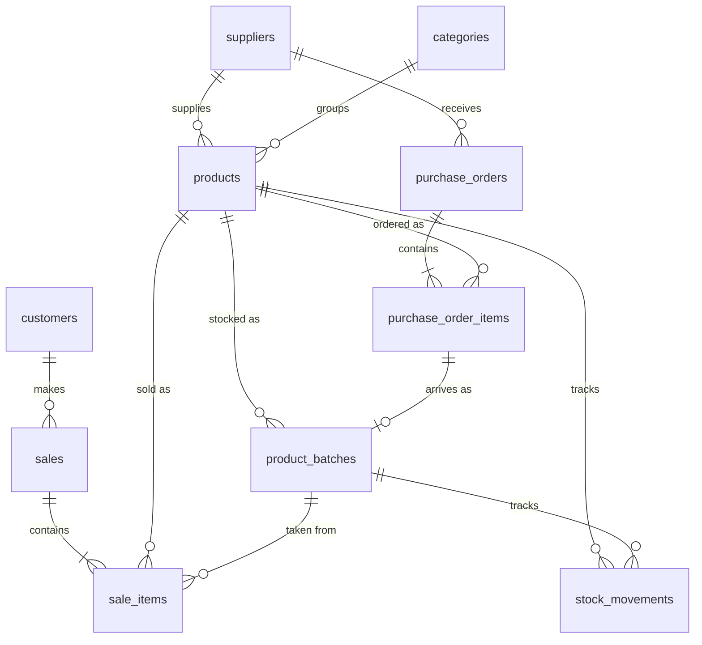

# Database Design: smart_inventory_db

## 1. The big idea

A product and a batch are different things.

- **Product** = *what* we sell ("Milk 500ml"). One row, price and reorder level live here.
- **Batch** = *a specific delivery* of that product, with its own expiry date and quantity.

Real stock lives in **batches**. Total stock of milk = sum of `quantity_remaining` over all milk batches.
This is what makes expiry tracking and FEFO (First-Expiry-First-Out) possible.

## 2. ER diagram

(GitHub renders this automatically.)

## 3. Tables

| # | Table | Purpose | Key columns |
|---|-------|---------|-------------|
| 1 | `suppliers` | Who we buy from | supplier_id (PK) |
| 2 | `categories` | Dairy, Grocery, ... | category_id (PK), category_name (UNIQUE) |
| 3 | `products` | What we sell | product_id (PK), sku (UNIQUE), category_id (FK), supplier_id (FK), reorder_level |
| 4 | `customers` | Who buys | customer_id (PK), phone (UNIQUE) |
| 5 | `purchase_orders` | Order sent to a supplier | po_id (PK), supplier_id (FK), status |
| 6 | `purchase_order_items` | Lines of an order | po_id (FK), product_id (FK) |
| 7 | `product_batches` | Actual stock with expiry | batch_id (PK), product_id (FK), expiry_date, quantity_remaining |
| 8 | `sales` | One bill | sale_id (PK), customer_id (FK, optional) |
| 9 | `sale_items` | Lines of a bill | sale_id (FK), product_id (FK), batch_id (FK) |
| 10 | `stock_movements` | Audit trail of every stock change | product_id (FK), batch_id (FK), quantity_change |

## 4. Concepts you should be able to explain in an interview

**Primary key (PK)**: a column that uniquely identifies each row (e.g. `product_id`). `AUTO_INCREMENT` makes MySQL assign 1, 2, 3...

**Foreign key (FK)**: a column that points to a PK in another table (e.g. `products.category_id` -> `categories.category_id`). MySQL refuses to save a product with a category that does not exist. That is *referential integrity*.

**One-to-many**: one supplier supplies many products; one sale has many sale items.

**Why `sales` and `sale_items` are separate**: a bill has a variable number of lines. Putting them in one table would repeat the date/customer on every row. Splitting data like this is called *normalization*.

**Constraints used**: `NOT NULL`, `UNIQUE` (sku, phone), `CHECK` (no negative prices or stock, batch remaining never above received), `DEFAULT`, `ENUM` (only allowed values, e.g. payment method).

**`ON DELETE` rules**:
- `CASCADE`: deleting a sale also deletes its items.
- `SET NULL`: deleting a supplier keeps the product but clears its supplier.
- (default) blocks deletion if rows still depend on it, which protects sales history.

**Indexes**: `idx_batch_expiry` and `idx_sales_date` make expiry and date-range queries fast as data grows.

**Why `sale_items.batch_id`?** It records which batch each sale came from, so we can deduct stock from the right batch and compute true profit using that batch's cost price.

**Why `stock_movements`?** If stock ever looks wrong, the audit trail shows exactly what happened. `quantity_change` is positive for stock in, negative for stock out.

## 5. How the workflow maps to tables

1. Shopkeeper adds a product -> `products`
2. Stock arrives from supplier -> `purchase_orders`, `purchase_order_items`, `product_batches`, `stock_movements`
3. Customer buys -> `sales`, `sale_items`
4. Inventory updates -> `product_batches.quantity_remaining` goes down, `stock_movements` gets a SALE row
5. Prediction (Phase 8) -> reads `sale_items` + `sales.sale_date` history
